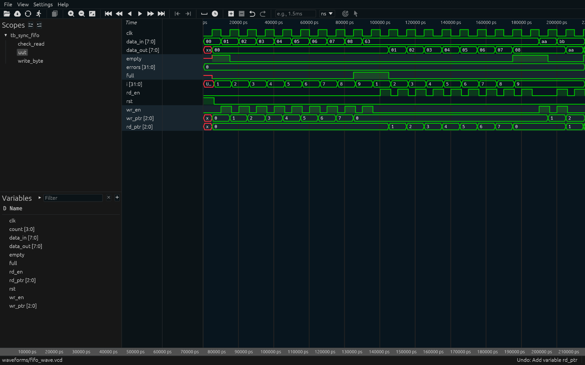

# Synchronous FIFO Design using Verilog

A parameterized **Synchronous First-In First-Out (FIFO)** implemented using synthesizable Verilog RTL. The design supports controlled data storage and retrieval, full and empty status detection, and simultaneous read/write operations.

The project demonstrates a basic RTL design and verification workflow using Icarus Verilog and Yosys.

## Project Overview

A FIFO is a hardware buffer used to temporarily store data between two digital modules operating in a system.

Data is retrieved in the same order in which it was written (First-In First-Out).

### Design Specifications

| Parameter | Value |
|---|---|
| FIFO type | Synchronous FIFO |
| Data width | 8 bits |
| Address width | 3 bits |
| FIFO depth | 8 entries |
| Total storage capacity | 64 bits |
| Clock | Single clock |
| Reset | Synchronous reset |
| RTL language | Verilog |

## Architecture

The FIFO consists of the following components:

- **Memory:** Stores incoming data.
- **Write pointer:** Tracks the next write location.
- **Read pointer:** Tracks the next read location.
- **Occupancy counter:** Tracks the number of stored entries.
- **Full flag:** Indicates when the FIFO has reached maximum capacity.
- **Empty flag:** Indicates when the FIFO contains no valid entries.

## Repository Structure

```text
synchronous-fifo-verilog/
│
├── rtl/
│   └── sync_fifo.v
│
├── testbench/
│   └── tb_sync_fifo.v
│
├── sim/
│
├── synthesis/
│   └── fifo_synthesis.txt
│
├── waveforms/
│
├── .gitignore
└── README.md
```

## Functional Verification

A self-checking Verilog testbench was developed to verify the FIFO functionality.

### Test Scenarios

| Test | Expected behaviour |
|---|---|
| Reset | FIFO initializes to empty |
| Write operation | Data is stored successfully |
| Full detection | Full flag asserts at capacity |
| Overflow protection | Writes are rejected when full |
| Read operation | Data is retrieved in FIFO order |
| Empty detection | Empty flag asserts when all entries are read |
| Underflow protection | Reads are rejected when empty |
| Simultaneous read/write | Both operations are exercised together |

### Simulation Results

**Result: ALL TESTS PASSED**

Simulation performed using Icarus Verilog 13.0.

## Waveform Analysis

The simulation generates a Value Change Dump (VCD) file for waveform inspection.

The waveform can be viewed using Surfer.

Signals analysed include:

- Clock and reset
- Read and write enables
- Input and output data
- Full and empty flags
- Internal read and write pointers
- FIFO occupancy counter

## RTL Synthesis

RTL synthesis was performed using **Yosys 0.71**.

The synthesized design was analysed using generic logic-cell statistics.

### Synthesis Results

| Metric | Result |
|---|---:|
| Total generic cells | 230 |
| Enabled flip-flops | 64 |
| Synchronous-reset enabled flip-flops | 18 |
| Multiplexers | 31 |
| AND gates | 37 |
| NAND gates | 33 |
| OR gates | 4 |
| XOR gates | 5 |
| XNOR gates | 4 |

The FIFO storage was inferred using flip-flops in this generic synthesis result rather than a dedicated memory macro.

**Note:** These are generic synthesis statistics, not technology-mapped ASIC area, power or timing measurements.

The complete synthesis report is available in `synthesis/fifo_synthesis.txt`.

## Tools and Technologies

- Verilog HDL
- Icarus Verilog – RTL simulation
- Surfer – waveform visualization
- Yosys – RTL synthesis
- Visual Studio Code
- Git and GitHub
- macOS / Apple Silicon

## Running the Project

### 1. Install the required tools

```bash
brew install icarus-verilog yosys surfer
```

### 2. Compile the RTL and testbench

```bash
iverilog -g2012 -o sim/fifo_test rtl/sync_fifo.v testbench/tb_sync_fifo.v
```

### 3. Run the simulation

```bash
vvp sim/fifo_test
```

### 4. Open the waveform

```bash
surfer waveforms/fifo_wave.vcd
```

The VCD file is generated by the testbench during simulation.

### 5. Run RTL synthesis

```bash
yosys -p "read_verilog rtl/sync_fifo.v; synth -top sync_fifo; stat" | tee synthesis/fifo_synthesis.txt
```
## Simulation Waveform

The waveform below demonstrates FIFO operation, including
write and read transactions, pointer updates, and full/empty
flag behaviour.



## Future Improvements

- Parameterized FIFO verification across different widths and depths.
- Randomized and constrained-random testing.
- Assertion-based verification.
- Timing analysis and technology-specific synthesis.
- FPGA implementation and resource utilization analysis.

## Author

**Cynthia Jane**

Electronics and Communication Engineering

GitHub: [cynthiajane](https://github.com/cynthiajane)

---

*An RTL design and verification project exploring synchronous FIFO architecture, functional simulation and logic synthesis.*
